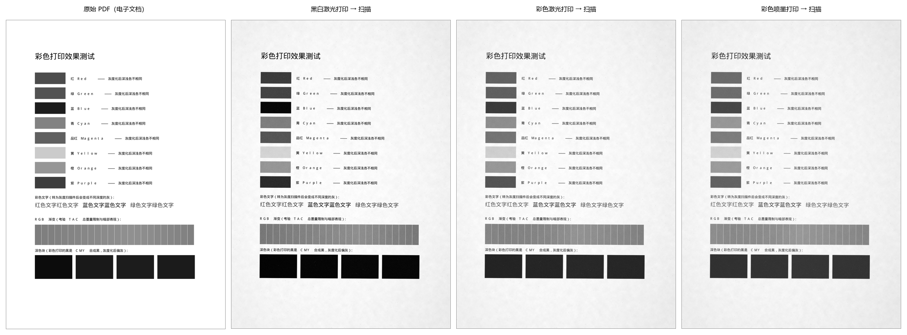
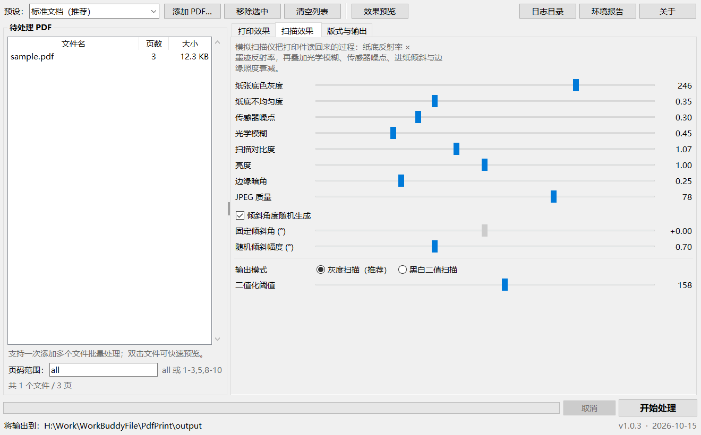
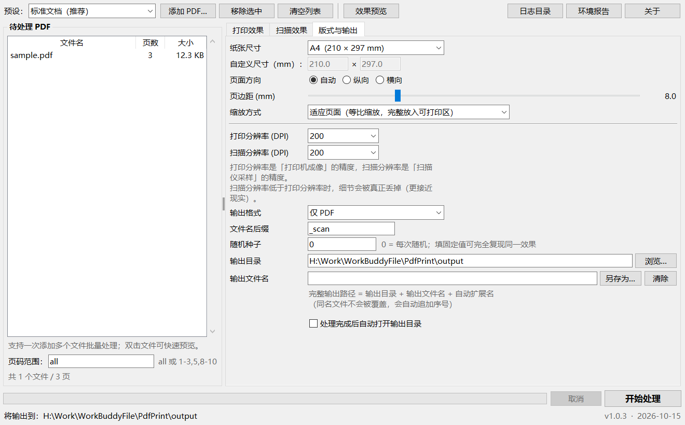
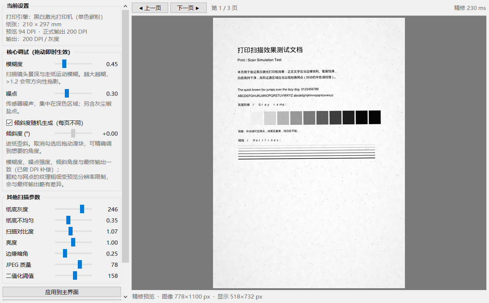

# PDF 打印扫描模拟器

[](https://github.com/wanwuyijian/PDF-Print/releases)
[]()
[](https://www.python.org/)
[](https://github.com/wanwuyijian/PDF-Print)

把 PDF 电子文档模拟成 **「打印机打印过、再被扫描仪扫成黑白件」** 的样子。

单文件 exe，免安装，双击即用。

---

## 📥 下载

**最新版：[`PDF-Print-Simulator_v1.0.3.exe`](https://github.com/wanwuyijian/PDF-Print/releases/download/v1.0.3/PDF-Print-Simulator_v1.0.3.exe)**（48.4 MB，单文件免安装）

或前往 **[Releases 页面](https://github.com/wanwuyijian/PDF-Print/releases)** 查看全部版本。

> 附件名用英文是因为 GitHub 会自动剔除 Release 附件名里的非 ASCII 字符，
> 中文名上传后会被洗成 `PDF._v1.0.3.exe`。程序本身的中文名和界面不受影响。

<details>
<summary>不想下载 exe？自己打包（约 1 分钟）</summary>

```bash
git clone https://github.com/wanwuyijian/PDF-Print.git
cd PDF-Print
pip install -r requirements.txt
python tools/build.py
```

产物在 `dist/` 目录。
</details>

### 运行要求

| 项 | 要求 |
|---|---|
| 操作系统 | Windows 10 / 11（x86-64）；Linux / macOS 亦可运行源码版 |
| 内存 | 建议 2GB 以上（处理 A4@300dpi 单页约占 500MB） |
| 安装 | **无需安装**，无需 Python 环境，无需联网 |
| 磁盘 | 系统临时目录需约 200MB 可用空间（单文件 exe 启动时解压运行环境） |

### 跨机使用 / 绿色部署

把 exe **单独复制**到另一台 Windows 10/11 电脑，双击即可运行：

- 不需要装 Python，不需要装任何运行库
- 日志、崩溃日志、参数配置自动建在 exe 旁边（绿色模式）
- 若 exe 所在目录不可写（如 `C:\Program Files`、只读介质、网络盘），
  会**自动改用** `%LOCALAPPDATA%\PdfPrintScanSimulator`，并在「关于」窗口说明
- 换电脑后遇到问题，点工具栏「**环境报告**」生成一份体检文件发出来即可

> **SmartScreen 提示**：程序未做代码签名。若 exe 是从浏览器下载的，
> Windows 可能提示「Windows 已保护你的电脑」——点「**更多信息 → 仍要运行**」即可。
> 从 U 盘、局域网或资源管理器直接复制通常不会触发。

### 出问题时先跑自检

```bash
PDF打印扫描模拟器_v1.0.3.exe --selftest
```

跑完弹窗给结论，并生成报告文件到 `logs/selftest_*.txt`，用于快速区分「环境问题」与「代码问题」。

---

## 它是怎么做的

不是简单套个滤镜 —— 程序按真实成像链路建模：

```
白纸反射率 0.96
      ↓  打印机上墨：R = 1 - 覆盖率 × (1 - 墨的反射率)
打印件（纸上已经是墨了）
      ↓  扫描仪灰度采样：G = 亮度(R) × 纸张灰度
黑白扫描件
```

所以下面这些现象是**自然产生**的，而不是硬做出来的：

| 现实现象 | 在模型里对应什么 |
|---|---|
| 黑白激光打印的黑字真黑、字口锐利 | 碳粉反射率下限 0.045 |
| 彩色打印的黑字扫描成灰度后**明显发灰** | 彩色机的黑是 CMY 合成黑，反射率下限 0.17 |
| 红字扫成灰后比黑字浅、黄字几乎看不见 | 色料的亮度权重不同（黄 ≈ 0.83，红 ≈ 0.42） |
| 纸底不是纯白，且有不均匀的云斑 | 纸基灰度 246 × 低频随机场 |
| 深色区域噪点明显、白纸很干净 | 传感器噪点与 (1−亮度) 相关 |
| 页面是歪的，边角还有点暗 | 进纸倾斜 + 边缘照度衰减 |

## 效果对比

同一页彩色内容，分别经三种打印引擎后扫描成黑白件的效果：



可以看出几个由物理模型自然产生的差异：

- **黑白激光**：红/蓝块压得很深，黄色几乎消失，黑块是真黑（反射率 0.045）
- **彩色激光**：同样的红块明显更浅（色料不同），黑块是灰的 —— 因为彩色机的黑由 CMY 叠印而成
- **彩色喷墨**：墨量更足但暗部发闷，整体偏青

## 界面

主界面：文件列表 + 三个参数页（打印效果 / 扫描效果 / 版式与输出）+ 实时预览入口。



「版式与输出」页可自由指定**输出目录**与**输出文件名**，「另存为…」一键填好完整路径；
同名文件自动加序号，不会覆盖你已有的文件。



预览窗口：模糊度、噪点、倾斜度三个核心滑块拖动即时生效，调好后一键回填主界面。



---

## 功能

| # | 能力 | 说明 |
|---|---|---|
| 1 | 黑白打印机打印 → 黑白扫描 | 黑白激光引擎（单色碳粉），黑字真黑、字口锐利 |
| 2 | 彩色打印机打印 → 黑白扫描 | 彩色激光（CMYK 四色叠印）、彩色喷墨两个引擎 |
| 3 | 可设输出纸张尺寸 | 12 种标准纸 + 自定义 + 保持原页面尺寸 |
| 4 | 效果预览实时调参 | 模糊度 / 噪点 / 倾斜度拖动即生效，可回填主界面 |
| 5 | **指定输出文件路径** | 输出目录 + 输出文件名自由组合，「另存为…」一键指定；同名自动加序号不覆盖 |
| 6 | 批量处理 | 一次多选 PDF，后台线程处理，可随时取消 |
| 7 | 版本管理 | 版本号单一来源，exe 属性自动同步 |
| 8 | 日志与崩溃记录 | 运行日志 + 独立崩溃快照（含全部线程栈与崩溃现场参数）+ 环境体检报告 |
| 9 | 自检模式 | `--selftest` 32 项检查，一条命令定位问题 |
| 10 | 跨机直接可用 | 单文件 exe 复制到任意 Windows 10/11 即可运行，无需安装、无需 Python |

支持的纸张：`A3` `A4` `A5` `A6` `B4` `B5` `16开` `32开` `Letter` `Legal` `54×86mm` `38×26mm` `自定义` `保持原尺寸`

---

## 快速开始

1. 下载并运行 exe
2. 点「添加 PDF…」选文件（可多选）
3. 右上角挑一个**预设**，或自己调参数
4. 点「效果预览」看效果，不满意就拖滑块，满意后点「应用到主界面」
5. 点「开始处理」

输出默认落在 exe 同目录的 `output/` 文件夹。

> 首次使用建议直接用预设里的「标准文档（推荐）」。

内置预设：`标准文档` `轻印淡扫` `重印浓扫` `老旧复印机` `黑白二值扫描` `彩色打印→黑白扫描`

---

## 参数说明

### 打印效果

| 参数 | 作用 | 建议范围 |
|---|---|---|
| 打印引擎 | 决定墨的物理特性（见上表） | — |
| 浓度 | 碳粉/墨量。>1 更黑更实，<1 淡印 | 0.8 ~ 1.2 |
| 阶调对比 | 打印机成像的阶调对比 | 0.9 ~ 1.2 |
| 墨点扩散 | 油墨在纸纤维上的毛细渗透，越大越糊 | 0.2 ~ 0.8 |
| 颗粒感 | 碳粉/墨滴转印的随机性 | 0.15 ~ 0.6 |
| 半色调网点 | 打印机用网点表现灰阶的强度 | 0.1 ~ 0.45 |
| 四色套印不准 | 仅彩色。CMYK 对位偏差造成的彩边 | 0.3 ~ 0.7 |
| 总墨量上限 | 仅彩色。越低暗部越糊、越闷 | 240 ~ 300 |

### 扫描效果

| 参数 | 作用 | 建议范围 |
|---|---|---|
| 纸张底色灰度 | 纸基不是纯白。真实扫描件多在 240~250 | 238 ~ 252 |
| 纸底不均匀度 | 纸张定量不匀 + 灯管不均造成的底色起伏 | 0.15 ~ 0.5 |
| 传感器噪点 | 暗部信噪比差，白纸几乎干净 | 0.15 ~ 0.5 |
| 光学模糊 | 景深 / 镜头 MTF / 走纸运动模糊 | 0.3 ~ 0.9 |
| 扫描对比度 | 扫描仪自动曝光的阶调拉伸 | 1.0 ~ 1.2 |
| 亮度 | 整体亮度增益 | 0.95 ~ 1.05 |
| 倾斜角度 | 进纸歪斜，可随机（每页不同）或固定 | 随机 ±0.7° 较自然 |
| 边缘暗角 | 边缘照度衰减 + 单侧盖板阴影 | 0.1 ~ 0.4 |
| JPEG 质量 | 越低数码味越重（二值模式自动改用无损） | 60 ~ 90 |
| 输出模式 | 灰度扫描 / 黑白二值扫描 | 灰度更真实 |

### 版式与输出

| 参数 | 说明 |
|---|---|
| 纸张尺寸 | 输出 PDF 的页面物理尺寸 |
| 页面方向 | 自动 = 跟随原页面方向 |
| 页边距 | 同时模拟打印机不可打印边距与扫描裁边 |
| 缩放方式 | 适应 / 填满 / 原尺寸 |
| 打印分辨率 | 打印机成像的精度（= 渲染分辨率） |
| 扫描分辨率 | 扫描仪采样的精度。低于打印分辨率时会真正丢细节 |
| 输出格式 | 仅 PDF / 仅 PNG / 仅 JPG / PDF + 图片 |
| 随机种子 | 0 = 每次随机；填固定值可 **100% 复现**同一效果 |

### 小技巧

- 想每次得到完全一样的结果？把「随机种子」从 0 改成固定数字（如 `12345`）
- 「扫描分辨率」设得比「打印分辨率」低，细节会真的被丢掉 —— 这更接近现实
- 「黑白二值扫描」得到只有纯黑纯白的文件，体积最小、字口最硬

---

## 版本管理

版本号只在一处定义：`src/app/version.py`

```python
__version__ = "1.0.3"
BUILD_DATE  = "2026-10-15"
```

改动后重新打包，exe 会自动带上正确的文件版本、产品版本与中文名：

```bash
python tools/build.py            # 正式构建（无控制台窗口）
python tools/build.py --debug    # 保留控制台窗口，方便看报错
```

产物：`dist/PDF打印扫描模拟器_v1.0.3.exe`（单文件，免安装）

版本变更记录见 [CHANGELOG.md](CHANGELOG.md)。

---

## 日志与故障排查

程序运行数据跟着 exe 走（exe 所在目录不可写时自动回落到 `%LOCALAPPDATA%\PdfPrintScanSimulator`）：

```
logs/app_YYYY-MM-DD.log                 运行日志（按天切分，单文件 5MB，保留 5 份）
logs/crash_YYYY-MM-DD_HHMMSS.log        崩溃日志（每次崩溃一个独立文件）
logs/selftest_YYYY-MM-DD_HHMMSS.txt     自检报告
config/last_state.json                  上次使用的参数（下次启动自动恢复）
output/                                 默认输出目录
```

**崩溃日志里包含**：程序版本、运行模式、系统与 Python 版本、完整 traceback、所有线程的调用栈，以及崩溃时正在处理的**文件路径与完整参数**。

> 遇到问题：把 `logs/crash_*.log` 发出来即可，不用复述现象。

程序内的「日志目录」按钮可以直接打开日志文件夹。

---

## 目录结构

```
PDF-Print/
├── src/
│   ├── main.py                  入口（设置 DPI 感知、兜住 stdout/stderr）
│   └── app/
│       ├── version.py           版本号唯一来源
│       ├── paths.py             运行路径解析（兼容打包后的 exe）
│       ├── logsetup.py          日志 + 三类崩溃钩子
│       ├── config.py            参数定义与内置预设
│       ├── paper.py             纸张尺寸表与单位换算
│       ├── effects.py           ★ 打印/扫描成像算法
│       ├── engine.py            PDF 流水线 + 预览会话
│       ├── selftest.py          自检模式
│       └── gui.py               主界面 + 预览窗口
├── assets/icon.ico
├── tools/                       开发脚本（造测试件、测试、打包、截图）
├── test/                        测试用 PDF
├── docs/                        README 用图
├── logs/  config/  output/      运行时生成（不入库）
├── README.md   CHANGELOG.md   使用说明.txt
└── requirements.txt
```

---

## 开发

```bash
# 环境（需要带 tkinter 的 Python）
pip install -r requirements.txt

# 源码运行
cd src && python main.py

# 测试
python tools/make_sample.py test/sample.pdf   # 生成测试 PDF
python tools/test_engine.py                   # 引擎冒烟测试
python tools/test_gui.py                      # 界面构建测试
python tools/test_preview.py                  # 预览实时调参测试
python tools/test_fidelity.py                 # 预览与最终输出的保真度验证
python tools/test_pagerange.py                 # 页码范围解析回归测试
python tools/make_showcase.py                 # 生成效果对比图
```

### 关于预览保真度

预览为了流畅会用较低分辨率渲染（拖动时 60%，松手后 100% 精修）。
但模糊 sigma、云斑尺度、椒盐点密度都是**按像素定义**的量，直接用会让预览
比实际输出糊 2~3 倍。因此 `PreviewSession` 会计算 `dpi_scale = 预览DPI / 输出DPI`
并传给效果函数做补偿。

`tools/test_fidelity.py` 会对补偿前后的边缘锐度做定量对比 —— 实测：

| 场景 | 未补偿的细节带能量 | 补偿后 |
|---|---|---|
| 强模糊 blur=1.60 | 仅真值的 **0.32 倍**（明显更糊） | 1.22 倍 |
| 常规 blur=0.45 | 0.89 倍 | 1.08 倍 |

### 已知限制

- 预览分辨率低于最终输出，**颗粒与网点的纹理粗细**会与最终输出略有差异
  （模糊、噪点强度、倾斜角度已做到一致）。预览窗口内已标注说明。
- 极少数 PDF 的 `/Rotate` 不会被渲染矩阵带出，代码里做了宽高方向的防呆补正。
- 加密 PDF 只支持空密码解锁。

---

## 反馈

遇到问题或效果不符合预期，欢迎提 Issue，附上 `logs/` 里的崩溃日志或自检报告会大幅加快定位。

## 许可

本仓库暂未添加开源许可证文件。若需二次分发或商用，请先与作者确认授权。